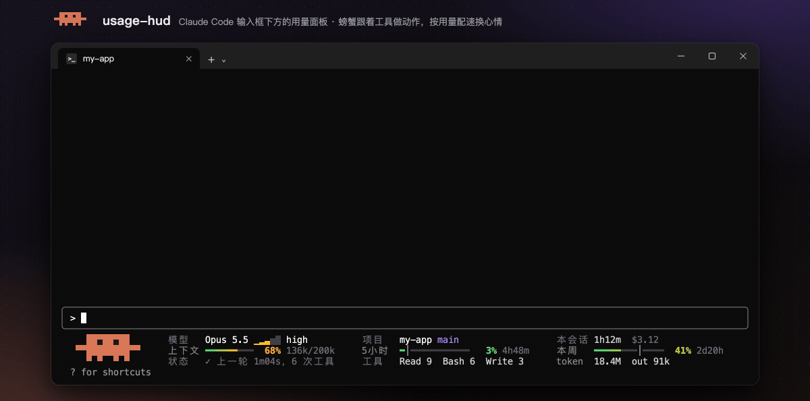
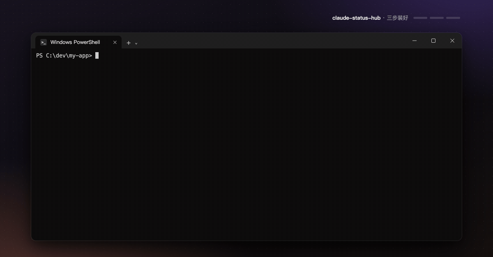
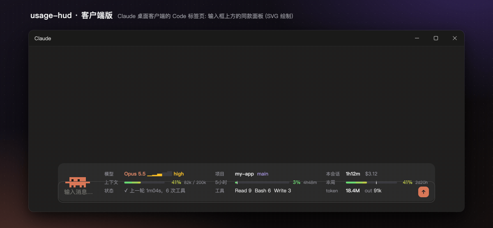

<div align="center">

# claude-status-hub

[English](README.md) | 简体中文

**给 Claude Code 终端补上「客户端才有」的顺手功能**

会动、有情绪的像素螃蟹用量面板 · 单击就开的文件链接 · 能复制、能填入的代码卡片

[](LICENSE)




</div>

## 这是什么

Claude Code 的 [mods](https://code.claude.com/docs/zh-CN/plugins/mods/overview) 是一种「函数钩子插件」：一个文件夹加几十行 TypeScript，就能改 Claude Code 自己画的界面。这个仓库有两个 mod，互不依赖，可以只装一个：

| mod | 做什么 |
|---|---|
| **usage-hud** | 输入框下方是用量面板，面板左边是一只像素螃蟹。螃蟹按 Claude 正在用的工具做动作、拿着道具，还会按额度消耗速度变情绪；面板上模型和思考档位、项目和分支、会话时长和花费、上下文 / 5 小时 / 本周用量、token 数，一眼看全 |
| **html-shelf** | 终端里 Claude 回复中的文件路径（HTML、PDF、图片、视频、文件夹…）单击就打开；代码块和文字里的命令画成带底色的卡片，一键复制或填入输入框 |

## 快速开始



**1. 添加插件市场**（在你的终端里运行）

```bash
claude plugin marketplace add SsageParuders/claude-status-hub
```

**2. 安装两个 mod**（只要一个就只装一个）

```bash
claude plugin install usage-hud@claude-status-hub
```

```bash
claude plugin install html-shelf@claude-status-hub
```

**3. 重新打开 claude**

运行 `/plugin`，标签下面那行灰字会写 `2 mods active` 和两个 mod 的名字。之后每个新会话（终端和桌面客户端）都会自动加载。

> 点击和悬停需要 Claude Code 的全屏渲染。没开的话，在 Claude Code 里运行 `/tui fullscreen`。

<details>
<summary>想改代码？用本地文件夹加载</summary>

克隆仓库后，把两个文件夹的绝对路径写进 `~/.claude/settings.json` 的 `env`。Windows 用 `;` 分隔，macOS / Linux 用 `:`。这样加载的 mod 在终端会话里一保存就重载。

```json
{
  "env": {
    "CLAUDE_CODE_PLUGIN_DIRS": "C:\\path\\to\\claude-status-hub\\usage-hud;C:\\path\\to\\claude-status-hub\\html-shelf"
  }
}
```

只想试一次、不改设置：

```bash
claude --plugin-dir ./claude-status-hub/usage-hud --plugin-dir ./claude-status-hub/html-shelf
```

</details>

**更新**：在 Claude Code 里运行 `/plugin marketplace update claude-status-hub`。也可以在 `/plugin` → Marketplaces 里给这个市场打开自动更新。

**装之前想先看它做什么**：mod 以你的权限运行。克隆仓库后运行 `claude plugin validate ./usage-hud`，输出的 `hooks:` 和 `calls:` 两行列出它挂了哪些事件、调用了什么。

## usage-hud：会动的用量面板

在终端里，usage-hud 在输入框下方画一个用量面板，面板左边是一只像素螃蟹（12 列螃蟹 + 右边 3 列道具，3 行高，不额外占行）。终端不到 66 列时面板换成 1 行，螃蟹换成 1 行高的小螃蟹。

面板是一个 3 行 × 3 列的网格，每列标签上下对齐：

| | 第 1 列 | 第 2 列 | 第 3 列 |
|---|---|---|---|
| 第 1 行 | 模型 + 思考档位 | 项目 + git 分支 | 本会话时长 + 花费 |
| 第 2 行 | 上下文用量 | 5 小时用量 | 本周用量 |
| 第 3 行 | 状态 | 用得最多的工具 | token 总数 + 输出（out） |

5 小时和本周的用量条上各有一道亮色竖线 `│`，表示这个窗口的时间过去了多少；条后面是到重置的短倒计时，比如 `1h54m`。彩色段越过竖线，说明额度用得比时间快。

没有 5 小时限制的账号（比如通过验证的 Ultra）：面板认出读数里只有本周，就不画 5 小时那格。完整版第 2 行变成「上下文 | 本周 | 重置」，第 3 格写本周额度的重置时刻（今天 / 明天 / 周几 + 时:分）和配速（比如 `配速 0.8x`，会用完时变红）；中等版右列变成「上下文 / 本周 / 本会话」；精简版直接去掉 5 小时那段。只要 5 小时读数重新出现，就恢复原样。

**螃蟹**（只在终端）待在面板左边，跟着 Claude 干活；右边 3 列画它手上的道具，身体颜色表示上下文用量：

| Claude 在做 | 螃蟹在做 |
|---|---|
| 思考、回复 | 眼睛往右看，头顶冒思考点点 |
| 读文件、搜索 | 看一页纸，扫描线上下移动 |
| 写文件、改文件 | 右钳敲，纸上慢慢写满字 |
| 跑命令 | 双钳交替敲键盘，终端光标闪烁 |
| 上网 | 旁边一个旋转的小地球 |
| 其他工具 | 旁边一个转动的小齿轮 |
| 一轮结束 | 举钳跳跃，金色闪光；状态格写「✓ 上一轮 3m12s，N 次工具」 |
| 子代理在跑 | 道具区右下角多一只蹦蹦跳跳的小螃蟹（道具缩成 3 行高挪到它上面，两样同时看得见）；主线程闲着时，大螃蟹眼睛看着小螃蟹，隔一会儿举钳给它加油打气。子代理都结束后小螃蟹慢慢淡出。有几个子代理，看状态格末尾的「+N代理」，点开就是子代理看板 |
| 你发出消息 | 跳一下 |
| 闲置 / 5 分钟没动 | 眨眼、左右张望、偶尔挥手 / 闭眼呼吸冒泡泡 |
| 上下文 ≥ 80% | 变红冒汗；≥ 95% 红色闪烁报警 |

只跑几十毫秒的工具（Glob、Read 这类）也会至少拿着道具 0.6 秒，连着几个工具之间不会闪回「思考中」。

**状态格会亮起事件**，约 5 秒后变回平常的状态；干活时只替换工具名，前面的跳动条和后面的计时照旧：

| 事件 | 状态格 |
|---|---|
| 一次提问做完（等后台子代理都回来才算） | 绿色「✓ 搞定 3m12s」，之后变成暗色的「✓ 上一轮 3m12s，N 次工具」；螃蟹举钳跳 |
| 额度的消耗速度变成「会在重置前用完」 | 红色加粗「慢点！40m用完」（每个额度窗口只说一次） |
| 上下文第一次到 75% | 黄色「上下文快满了，可以压缩」（「上下文」那格同时出现「压缩」按钮） |
| 压缩完成 | 绿色「✓ 压缩完了」 |
| 额度重置 | 绿色「✓ 5 小时额度刷新了」，螃蟹举钳跳一下（同时弹出提示） |

**螃蟹还有情绪，跟着额度的消耗速度走**（配速 = 实际用量 ÷ 按时间该用的量）：

| 额度情况 | 螃蟹 | 面板 |
|---|---|---|
| 明显偏快，按这个速度会在重置前用完 | 头边冒汗 | 百分比和倒计时变红，写成「40m用完」 |
| 30 分钟内就会用完，或已用 ≥ 95% | 举钳慌张发抖，旁边一个大「!」 | 同上 |

`/hud crab off` 不画螃蟹，网格占满整行。

**更多实用的小功能**

- **每轮收据**：每轮结束那行后面多一段，比如 `· $0.42 · 改 2 个文件 +5 -1 · 工具 3 次`（只在终端）。
- **一键压缩**：上下文到 75% 时，「上下文」那格出现「压缩」按钮，点一下运行 `/compact`。
- **额度恢复提醒**：5 小时或本周额度用到 30% 以上、之后重置了，弹一次提示「额度已恢复，可以继续了」，状态格也亮一下。
- **子代理看板**：`/hud agents` 或点状态格里的「+N代理」，打开侧边面板。看每个子代理跑了多久、多久没动静、最后用的工具；超过 5 分钟没动静的标红「可能卡住」。

面板上可以点：模型名 → `/model`，思考档位 → `/effort`，项目名 → 打开项目文件夹，上下文 → `/context`，5 小时 / 本周 → `/usage`，token → 明细，「+N代理」→ 子代理看板。

窗口窄的时候面板会自动收缩：96 列以上是螃蟹 + 完整的 3 行 × 3 列，66–95 列（比如 macOS 默认的 80 列）是螃蟹 + 3 行 × 2 列，不到 66 列只显示一行（开头一只 1 行高的小螃蟹）。关掉螃蟹时各档分界前移 17 列。终端里面板固定在输入框下方。

| 命令 | 作用 |
|---|---|
| `/hud` | 完整 → 精简（一行）→ 隐藏，循环切换 |
| `/hud agents` | 打开子代理看板，Esc 关闭 |
| `/hud crab`、`/hud crab on`、`/hud crab off` | 开关螃蟹（默认开） |

在桌面客户端里，面板换成一张专用的 SVG 卡片（螃蟹 + 仪表盘），放在输入框上方，无边框，跟随浅色 / 深色主题：



- 「花费」是按 API 标价折算的等价金额，和 `/cost` 同一口径。订阅用户不会真的被扣这笔钱。
- token 数来自会话记录（含子代理），读缓存也算在内，所以数字通常很大。

## html-shelf：可点的链接和代码卡片


- **文件路径变成链接**：回复里出现的路径（裸路径、`` `代码` ``、`[文字](路径)` 都行），单击用默认程序打开。文件真实存在才会变成链接。
  - 支持 HTML、Markdown、PDF、图片（png / jpg / gif / svg …）、音视频（mp4 / mov / mp3 …）、Office 文件（docx / xlsx / pptx）、csv、txt。
  - 也支持文件夹：用文件管理器打开。
  - 脚本和可执行文件（bat、ps1、sh、py、exe …）**不会被运行**，单击只在文件夹里选中它。
- **工具行的 Open 按钮**：Claude 写完一个文件，`Write(...)` 那一行后面就带 Open 按钮。
- **`/open`**：`/open` 打开最近一个文件，`/open 3` 打开倒数第 3 个，`/open list` 列出最近 10 个，单击打开。
- **代码卡片**：每个代码块画成一张卡片，标题栏左边是语言名，右边是按钮。
  - Copy：复制原文，末尾不带换行，粘进终端不会直接执行。
  - Insert：单行 shell 命令会多这个按钮（没标语言、但只有一行命令的也算，比如以 `!` 开头的），把命令以 `!` 开头填进输入框，按回车才在本机运行。输入框里有没发出的字时不覆盖。
  - 写在文字里的命令（反引号括起来的，比如 `` `python -m unittest -v x.py` ``）也补一张卡片，放在那一段、那个列表项或那张表格后面。只认明显是命令的：以 `!` 开头，或 python、powershell、git、npm、claude 这类程序带参数。同一条命令只补一张，每条回复最多 6 张。
  - 鼠标移上去标题栏变亮、按钮变橙色；点完显示绿色 Copied ✓。
  - 卡片颜色取自 Claude Code 当前主题，深色和浅色主题都合适。
- **复制全文**：鼠标停在一条回复上，右上角出现 Copy all 按钮，复制这一段原文（去掉多余的缩进）。
- 代码卡片、按钮和非 HTML 链接只在终端里出现。桌面客户端本来就有这些，不动。

## 环境要求

| 项目 | 说明 |
|---|---|
| Claude Code | 终端版 2.1.287 及以上，桌面客户端 2.1.286 及以上（官方对 mods 的要求）。在 2.1.289（Windows）和 2.1.290（WSL）上测试 |
| 系统 | **Windows**：Windows 11 + Windows Terminal 真机测试。**Linux**：在 WSL（Ubuntu 22.04）里实测过插件测试和打开文件 / 文件夹的命令。**macOS**：只做了模拟测试，遇到问题欢迎提 issue |
| 打开方式 | Windows 用 `explorer.exe` / `cmd start`；macOS 用 `open`；Linux 用 `xdg-open`，不行再试 `gio open`；WSL 里优先交给 Windows 的默认程序（`wslview`，没有就经 `wslpath` 交给 `explorer.exe`） |
| 渲染 | 点击、悬停需要全屏渲染（`/tui fullscreen`） |
| 依赖 | Node.js（usage-hud 用一个小脚本统计 token，要能在 PATH 里找到）、git（显示分支）；Linux（非 WSL）打开文件要有 xdg-utils |

- macOS 的桌面客户端里，如果 Node.js 是用 Homebrew 或 nvm 装的，客户端可能找不到它。这时 token 一栏会退回只显示「本次启动」以来的数，其他不受影响。
- 设置了 `CLAUDE_CONFIG_DIR` 的话，usage-hud 会到那个目录下找会话记录。

## 卸载

移除插件市场，会连同装过的 mod 一起卸载：

```bash
claude plugin marketplace remove claude-status-hub
```

用本地文件夹加载的，从 `CLAUDE_CODE_PLUGIN_DIRS` 里删掉对应路径，重新打开 claude 即可。

## 开发

检查和测试一个 mod：

```bash
claude plugin validate ./usage-hud
```

```bash
claude plugin test ./usage-hud
```

- 终端会话会监视 mod 文件夹，保存即重载。桌面客户端会话不会，要运行 `/reload-plugins`。
- 改完把 `plugin.json` 的 `version` 升一级：usage-hud 在客户端里发现版本变了，会自己重载一次。
- 终端里只用 ASCII、中文、`│ ─ ━ ✓` 和方块字符。`• ⏱ ↻ ✦` 这类字符在有些终端里宽度不定，会和旁边的字重叠。
- `node tools/preview-client.mjs`：不开客户端，直接生成客户端面板的预览页 `tools/out/client.html`。
- `tools/demo/`：README 里这些动图的生成脚本。

```
usage-hud/
  hooks/register.tsx        各种事件、取数，把面板画成界面组件
  hooks/panel.ts            终端面板和子代理看板的排版、客户端卡片的数据（纯函数，README 动图也直接用）
  hooks/sprites.ts          像素螃蟹（纯函数，README 动图也直接用）
  hooks/desktop.ts          客户端面板（SVG）
  scripts/count-tokens.js   统计一个会话用掉的 token（含子代理）
html-shelf/
  hooks/register.tsx        链接、代码卡片、/open
tools/                      预览和动图脚本
assets/                     README 用的动图
```

## 许可证

[MIT](LICENSE) © 2026 Ronan, SsageParuders

最初来自 Ronan 的 [ronanworks/claude-code-mods](https://github.com/ronanworks/claude-code-mods)。
